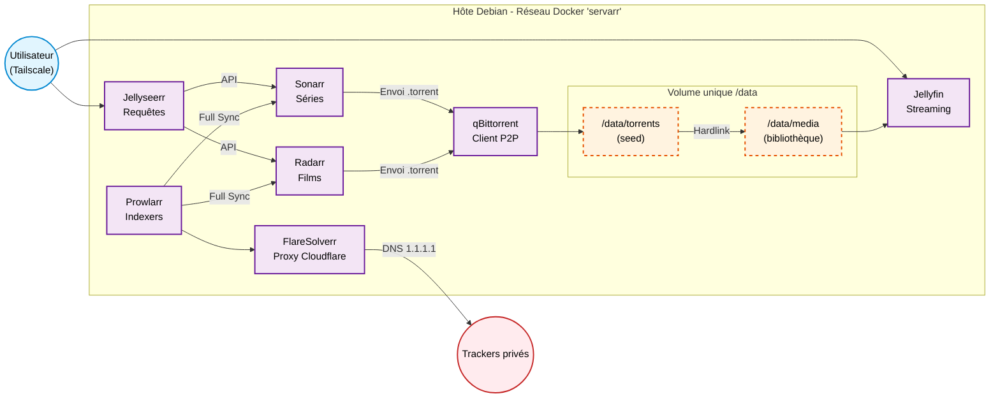

# Documentation Technique : Infrastructure Multimédia Automatisée (Docker / Servarr)

Ce document fournit un guide pas-à-pas pour reproduire, configurer et maintenir une infrastructure de streaming personnelle et automatisée. L'architecture repose sur Docker sous Debian, avec une sécurisation des flux P2P, une optimisation du stockage par liens physiques (hardlinks) et un cloisonnement réseau via Tailscale.

---

## Sommaire

1. [Architecture et principes fondamentaux](#1-architecture-et-principes-fondamentaux)
2. [Prérequis et installation du socle](#2-prérequis-et-installation-du-socle)
3. [Préparation du système et arborescence](#3-préparation-du-système-et-arborescence)
4. [Fichier de déploiement (Docker Compose)](#4-fichier-de-déploiement-docker-compose)
5. [Configuration post-déploiement](#5-configuration-post-déploiement)
6. [Vérifications et tests](#6-vérifications-et-tests)
7. [Maintenance et résolution d'incidents](#7-maintenance-et-résolution-dincidents)
8. [Sauvegarde et restauration](#8-sauvegarde-et-restauration)
9. [Avertissement légal](#9-avertissement-légal)

---

## 1. Architecture et principes fondamentaux

| Composant | Choix technique |
|---|---|
| Système hôte | Debian Linux |
| Conteneurisation | Docker Engine + plugin Docker Compose v2 (images linuxserver.io) |
| Accès distant | Nœud Tailscale (100.x.x.x). Aucun port des interfaces web exposé sur Internet |
| Réseau inter-conteneurs | Réseau bridge Docker dédié (`servarr`), résolution par nom de conteneur |
| Stockage | Volume racine unique `/data` partagé, hardlinks entre seed et médiathèque |
| Contournement | DNS publics (1.1.1.1 / 8.8.8.8) au niveau des conteneurs + proxy FlareSolverr (Cloudflare) |

### Rôle de chaque service

| Service | Rôle | Port interne |
|---|---|---|
| Jellyfin | Serveur de streaming (lecture des médias) | 8096 |
| Jellyseerr | Portail de requêtes utilisateurs | 5055 |
| Sonarr | Orchestration PVR des séries | 8989 |
| Radarr | Orchestration PVR des films | 7878 |
| Prowlarr | Gestionnaire centralisé des indexers | 9696 |
| FlareSolverr | Proxy de résolution des challenges Cloudflare | 8191 (interne uniquement) |
| qBittorrent | Client de téléchargement P2P | 8080 (WebUI), 6881 (P2P) |

### Schéma de la chaîne



### Pourquoi un volume unique ?

Un hardlink ne peut exister qu'au sein d'un même système de fichiers. Si Docker monte `/downloads` et `/movies` comme deux volumes distincts, le conteneur les voit comme deux systèmes de fichiers différents. Le hardlink devient alors impossible : Sonarr/Radarr se rabattent sur une copie, ce qui double l'espace disque utilisé et augmente les I/O. Monter un seul `/data` dans tous les conteneurs qui manipulent des fichiers résout ce problème.

---

## 2. Prérequis et installation du socle

### 2.1 Docker Engine et Compose v2

```bash
sudo apt update
sudo apt install -y ca-certificates curl
sudo install -m 0755 -d /etc/apt/keyrings
sudo curl -fsSL https://download.docker.com/linux/debian/gpg -o /etc/apt/keyrings/docker.asc
sudo chmod a+r /etc/apt/keyrings/docker.asc

echo "deb [arch=$(dpkg --print-architecture) signed-by=/etc/apt/keyrings/docker.asc] \
https://download.docker.com/linux/debian $(. /etc/os-release && echo "$VERSION_CODENAME") stable" \
| sudo tee /etc/apt/sources.list.d/docker.list > /dev/null

sudo apt update
sudo apt install -y docker-ce docker-ce-cli containerd.io docker-compose-plugin
```

Vérification :

```bash
docker --version
docker compose version
```

> Note : la commande moderne est `docker compose` (avec un espace). L'ancien binaire `docker-compose` (v1) n'est plus maintenu.

### 2.2 Tailscale

```bash
curl -fsSL https://tailscale.com/install.sh | sh
sudo tailscale up
tailscale ip -4        # Noter l'IP 100.x.x.x de l'hôte
```

### 2.3 Démarrage de Docker après Tailscale

Les ports des conteneurs sont liés à l'IP Tailscale (voir section 4). Si Docker démarre avant que l'interface `tailscale0` ait obtenu son IP, les conteneurs échouent avec l'erreur `cannot assign requested address`. Deux protections cumulables :

```bash
# 1. Autoriser la liaison sur une IP pas encore présente
echo "net.ipv4.ip_nonlocal_bind = 1" | sudo tee /etc/sysctl.d/99-nonlocal-bind.conf
sudo sysctl --system

# 2. Ordonner le démarrage de Docker après tailscaled
sudo systemctl edit docker.service
```

Contenu à ajouter dans l'override :

```ini
[Unit]
After=tailscaled.service
Wants=tailscaled.service
```

```bash
sudo systemctl daemon-reload
```

---

## 3. Préparation du système et arborescence

### 3.1 Création de l'arborescence

```bash
sudo mkdir -p /mediatheque/data/{torrents/{tv-sonarr,radarr,logiciels},media/{movies,tv}}
sudo mkdir -p /mediatheque/config/{qbittorrent,prowlarr,radarr,sonarr,jellyfin,jellyseerr}
```

Arborescence obtenue :

```
/mediatheque
├── docker-compose.yml
├── .env
├── config/
│   ├── jellyfin/
│   ├── jellyseerr/
│   ├── prowlarr/
│   ├── qbittorrent/
│   ├── radarr/
│   └── sonarr/
└── data/                    <- monté en /data dans les conteneurs
    ├── torrents/            <- zone de seed (qBittorrent)
    │   ├── logiciels/
    │   ├── radarr/
    │   └── tv-sonarr/
    └── media/               <- bibliothèque (Jellyfin)
        ├── movies/
        └── tv/
```

> Éviter de placer les données dans `/home` : les permissions restrictives des répertoires utilisateurs posent régulièrement des problèmes d'accès aux conteneurs.

### 3.2 Gestion des permissions

Identifier l'UID/GID de l'utilisateur qui exécutera les conteneurs :

```bash
id $USER
# uid=1000(user) gid=1000(user) ...
```

Appliquer les droits (répertoires en 775, fichiers en 664) :

```bash
sudo chown -R 1000:1000 /mediatheque
sudo chmod -R a=,a+rX,u+w,g+w /mediatheque/data
```

La variable `UMASK=002` dans le compose garantit que les fichiers créés ultérieurement par les conteneurs conservent ces droits.

---

## 4. Fichier de déploiement (Docker Compose)

Tous les fichiers sont placés dans `/mediatheque`.

### 4.1 Fichier `.env`

```bash
cd /mediatheque
nano .env
```

```ini
# Identité des processus dans les conteneurs
PUID=1000
PGID=1000
UMASK=002
TZ=Europe/Paris

# IP Tailscale de l'hôte (tailscale ip -4)
# Les interfaces web ne seront joignables que via le tunnel Tailscale.
BIND_IP=100.x.x.x
```

> Le fichier `.env` doit être ajouté au `.gitignore` du dépôt.

### 4.2 Fichier `docker-compose.yml`

```yaml
networks:
  servarr:
    driver: bridge

services:
  qbittorrent:
    image: lscr.io/linuxserver/qbittorrent:latest
    container_name: qbittorrent
    environment:
      - PUID=${PUID}
      - PGID=${PGID}
      - UMASK=${UMASK}
      - TZ=${TZ}
      - WEBUI_PORT=8080
      - TORRENTING_PORT=6881
    volumes:
      - ./config/qbittorrent:/config
      - ./data:/data                    # Racine commune pour les hardlinks
    ports:
      - ${BIND_IP}:8080:8080            # WebUI accessible uniquement via Tailscale
      - 6881:6881                       # Port P2P (voir note ci-dessous)
      - 6881:6881/udp
    networks:
      - servarr
    restart: unless-stopped

  flaresolverr:
    image: ghcr.io/flaresolverr/flaresolverr:latest
    container_name: flaresolverr
    environment:
      - LOG_LEVEL=info
      - TZ=${TZ}
    dns:
      - 1.1.1.1                         # C'est FlareSolverr qui contacte réellement le tracker
      - 8.8.8.8
    # Aucun port publié : seul Prowlarr y accède via le réseau interne
    networks:
      - servarr
    restart: unless-stopped

  prowlarr:
    image: lscr.io/linuxserver/prowlarr:latest
    container_name: prowlarr
    environment:
      - PUID=${PUID}
      - PGID=${PGID}
      - UMASK=${UMASK}
      - TZ=${TZ}
    dns:
      - 1.1.1.1                         # Contournement du filtrage DNS FAI
      - 8.8.8.8
    volumes:
      - ./config/prowlarr:/config       # Pas besoin d'accès à /data
    ports:
      - ${BIND_IP}:9696:9696
    networks:
      - servarr
    depends_on:
      - flaresolverr
    restart: unless-stopped

  radarr:
    image: lscr.io/linuxserver/radarr:latest
    container_name: radarr
    environment:
      - PUID=${PUID}
      - PGID=${PGID}
      - UMASK=${UMASK}
      - TZ=${TZ}
    volumes:
      - ./config/radarr:/config
      - ./data:/data                    # Racine commune pour les hardlinks
    ports:
      - ${BIND_IP}:7878:7878
    networks:
      - servarr
    depends_on:
      - qbittorrent
      - prowlarr
    restart: unless-stopped

  sonarr:
    image: lscr.io/linuxserver/sonarr:latest
    container_name: sonarr
    environment:
      - PUID=${PUID}
      - PGID=${PGID}
      - UMASK=${UMASK}
      - TZ=${TZ}
    volumes:
      - ./config/sonarr:/config
      - ./data:/data                    # Racine commune pour les hardlinks
    ports:
      - ${BIND_IP}:8989:8989
    networks:
      - servarr
    depends_on:
      - qbittorrent
      - prowlarr
    restart: unless-stopped

  jellyfin:
    image: lscr.io/linuxserver/jellyfin:latest
    container_name: jellyfin
    environment:
      - PUID=${PUID}
      - PGID=${PGID}
      - UMASK=${UMASK}
      - TZ=${TZ}
    volumes:
      - ./config/jellyfin:/config
      - ./data/media:/data/media:ro     # Lecture seule : Jellyfin ne peut rien supprimer
    # Optionnel : transcodage matériel Intel/AMD (VAAPI / QSV)
    # devices:
    #   - /dev/dri:/dev/dri
    ports:
      - ${BIND_IP}:8096:8096
    networks:
      - servarr
    restart: unless-stopped

  jellyseerr:
    image: fallenbagel/jellyseerr:latest
    container_name: jellyseerr
    environment:
      - LOG_LEVEL=info
      - TZ=${TZ}
    volumes:
      - ./config/jellyseerr:/app/config
    ports:
      - ${BIND_IP}:5055:5055
    networks:
      - servarr
    depends_on:
      - jellyfin
      - radarr
      - sonarr
    restart: unless-stopped
```

> **Note sur le port P2P 6881** : c'est le seul port qui peut avoir un intérêt côté WAN. Sans redirection de ce port sur la box, le client reste en mode "passif" (non connectable) : il fonctionne, mais ne peut se connecter qu'aux pairs connectables, ce qui pénalise le ratio sur les trackers privés. La redirection est un choix assumé ; les interfaces web, elles, restent strictement limitées à Tailscale.

> **Note sur Jellyseerr** : le projet Jellyseerr est en cours de fusion avec Overseerr sous le nom **Seerr** (organisation `seerr-team`). Un guide de migration officiel est disponible sur `docs.seerr.dev`. La configuration ci-dessous reste valable dans les deux cas.

### 4.3 Déploiement

```bash
cd /mediatheque
sudo docker compose up -d
sudo docker compose ps
```

---

## 5. Configuration post-déploiement

L'ordre ci-dessous respecte les dépendances de la chaîne : chaque application a besoin que la précédente soit opérationnelle (et de sa clé API).

Toutes les communications inter-conteneurs utilisent le **nom du conteneur** (ex. `http://radarr:7878`) et non une IP : la résolution est assurée par le DNS interne de Docker, insensible aux changements d'IP.

| Interface | URL (via Tailscale) |
|---|---|
| qBittorrent | `http://100.x.x.x:8080` |
| Prowlarr | `http://100.x.x.x:9696` |
| Radarr | `http://100.x.x.x:7878` |
| Sonarr | `http://100.x.x.x:8989` |
| Jellyfin | `http://100.x.x.x:8096` |
| Jellyseerr | `http://100.x.x.x:5055` |

### Étape 5.1 : qBittorrent (sécurité P2P et catégories)

**Premier accès** : l'image linuxserver génère un mot de passe temporaire pour l'utilisateur `admin` au premier démarrage.

```bash
sudo docker logs qbittorrent 2>&1 | grep -i password
```

Le modifier immédiatement dans `Options > Interface Web > Authentification`.

**Téléchargements** (`Options > Téléchargements`) :

- Mode de gestion des torrents par défaut : **Automatique** (indispensable pour que les chemins des catégories soient appliqués).
- Chemin de sauvegarde par défaut : `/data/torrents`.

**Sécurité trackers privés** (`Options > BitTorrent`) :

- Mode de chiffrement : **Exiger le chiffrement**.
- **Décocher** "Activer le réseau DHT", "Activer l'échange de pairs (PeX)" et "Activer la découverte locale de pairs (LSD)". Sur un tracker privé, les pairs doivent provenir exclusivement du tracker ; ces mécanismes décentralisés exposent l'IP hors du tracker et sont interdits par la plupart des règlements.

**Connexion** (`Options > Connexion`) :

- Port pour les connexions entrantes : `6881` (identique au port publié dans le compose).
- Décocher "Utiliser la redirection de port UPnP / NAT-PMP" (inopérant dans un conteneur bridge).

**Limites de partage** (`Options > BitTorrent`) :

- Ratio de partage maximal : **1.0**.
- Action lorsque la limite est atteinte : **Mettre en pause** (libellé **Arrêter le torrent** depuis qBittorrent 5.x).

**Catégories** (clic droit dans le panneau latéral > Ajouter une catégorie) :

| Catégorie | Chemin de sauvegarde |
|---|---|
| `radarr` | `/data/torrents/radarr` |
| `tv-sonarr` | `/data/torrents/tv-sonarr` |
| `logiciels` | `/data/torrents/logiciels` |

### Étape 5.2 : Prowlarr (indexers et FlareSolverr)

**Proxy FlareSolverr** (`Settings > Indexers > Indexer Proxies > +`) :

- Type : FlareSolverr
- Tags : `flaresolverr`
- Host : `http://flaresolverr:8191`

> **Fonctionnement des tags** : le proxy FlareSolverr n'est utilisé **que** par les indexers portant le même tag. Un indexer sans tag n'utilisera jamais FlareSolverr. Ajouter donc le tag `flaresolverr` uniquement aux indexers protégés par Cloudflare.

**Ajout des indexers** (`Indexers > Add Indexer`) :

- Renseigner les identifiants, le cookie ou la clé API du tracker.
- Ajouter le tag `flaresolverr` si le tracker est derrière Cloudflare.
- Cliquer sur **Test** avant d'enregistrer.

**Synchronisation vers Sonarr et Radarr** (`Settings > Apps > +`) :

| Paramètre | Sonarr | Radarr |
|---|---|---|
| Sync Level | Full Sync | Full Sync |
| Prowlarr Server | `http://prowlarr:9696` | `http://prowlarr:9696` |
| Server | `http://sonarr:8989` | `http://radarr:7878` |
| API Key | `Sonarr > Settings > General` | `Radarr > Settings > General` |
| Tags | **vide** | **vide** |

> **Point de vigilance** : ce sont les tags de **l'application** qui filtrent la synchronisation. Si une application porte un tag, seuls les indexers ayant ce même tag lui sont envoyés. En laissant le champ Tags de l'application vide, tous les indexers sont synchronisés, y compris ceux tagués `flaresolverr`.

Avec Full Sync, Prowlarr est la seule source de vérité : tout ajout, modification ou suppression d'indexer est répercuté automatiquement. Ne jamais modifier les indexers directement dans Sonarr/Radarr (les changements seraient écrasés).

### Étape 5.3 : Radarr et Sonarr (orchestration PVR)

La configuration est identique pour les deux applications, seules les valeurs changent.

**Gestion des médias** (`Settings > Media Management`, cocher **Show Advanced**) :

- **Use Hardlinks instead of Copy** : activé.
- Rename Movies / Rename Episodes : activé (recommandé pour une bibliothèque propre dans Jellyfin).
- **Root Folders** : ajouter `/data/media/movies` (Radarr) ou `/data/media/tv` (Sonarr).

**Client de téléchargement** (`Settings > Download Clients > + > qBittorrent`) :

| Paramètre | Radarr | Sonarr |
|---|---|---|
| Host | `qbittorrent` | `qbittorrent` |
| Port | `8080` | `8080` |
| Username / Password | identifiants WebUI | identifiants WebUI |
| Category | `radarr` | `tv-sonarr` |
| Remove Completed | activé | activé |

> **Fonctionnement de "Remove Completed"** : Sonarr/Radarr ne suppriment un torrent de qBittorrent qu'une fois l'import terminé **et** le torrent arrêté pour cause d'objectif de partage atteint (ratio 1.0). C'est la combinaison "ratio max + mise en pause" dans qBittorrent qui déclenche le nettoyage. Le fichier dans la bibliothèque n'est pas affecté (le hardlink survit).

> Un ratio peut aussi être défini par indexer dans Prowlarr / Sonarr / Radarr (champ "Seed Ratio"). S'il est renseigné, il est transmis à qBittorrent et prend le pas sur la limite globale du client.

**Notification Jellyfin** (`Settings > Connect > + > Emby / Jellyfin`) :

- Host : `jellyfin`, Port : `8096`.
- API Key : générée dans `Jellyfin > Tableau de bord > Clés API`.
- Cocher "Update Library" : la bibliothèque Jellyfin est rafraîchie immédiatement après chaque import.

### Étape 5.4 : Jellyfin

1. Suivre l'assistant de premier lancement (création du compte administrateur).
2. Ajouter les bibliothèques :
   - Films : `/data/media/movies`
   - Séries : `/data/media/tv`
3. Langue des métadonnées : Français.
4. Optionnel : activer le transcodage matériel (`Tableau de bord > Lecture > Transcodage`) si `/dev/dri` est monté.

### Étape 5.5 : Jellyseerr

1. Choisir **Jellyfin** comme serveur média : URL `http://jellyfin:8096`, puis se connecter avec le compte administrateur Jellyfin.
2. Synchroniser et activer les bibliothèques.
3. Ajouter Radarr (`Settings > Services`) :
   - Hostname : `radarr`, Port : `7878`, API Key.
   - Quality Profile et Root Folder `/data/media/movies`.
   - Cocher **Default Server**.
4. Ajouter Sonarr :
   - Hostname : `sonarr`, Port : `8989`, API Key.
   - Root Folder `/data/media/tv`.
   - Cocher **Default Server**.
5. Importer les utilisateurs Jellyfin et définir leurs permissions (requêtes auto-approuvées ou non).

---

## 6. Vérifications et tests

### 6.1 Validation des hardlinks

Après un premier import, vérifier que le fichier n'existe qu'une seule fois sur le disque :

```bash
# Le compteur de liens (3e colonne) doit être à 2
ls -li /mediatheque/data/media/movies/*/*.mkv

# Les deux chemins doivent partager le même numéro d'inode
stat -c '%i %h %n' /mediatheque/data/torrents/radarr/<release>/*.mkv
stat -c '%i %h %n' /mediatheque/data/media/movies/<Film (Année)>/*.mkv

# Lister les fichiers de la bibliothèque qui ne sont PAS des hardlinks
find /mediatheque/data/media -type f -links 1
```

L'espace réellement consommé peut être vérifié avec `du` : les hardlinks ne sont comptés qu'une seule fois.

```bash
du -sh /mediatheque/data
```

### 6.2 Validation de la résolution DNS et de FlareSolverr

```bash
# Résolution DNS depuis Prowlarr
sudo docker exec prowlarr cat /etc/resolv.conf

# FlareSolverr opérationnel (réponse JSON attendue)
sudo docker exec prowlarr curl -s http://flaresolverr:8191
```

### 6.3 Validation de l'exposition réseau

```bash
# Les interfaces web doivent écouter uniquement sur l'IP 100.x.x.x
sudo ss -tlnp | grep -E '8080|9696|7878|8989|8096|5055'
```

---

## 7. Maintenance et résolution d'incidents

### Scénario 1 : Perte des identifiants Radarr / Sonarr (lock-out)

Si la mire de connexion bloque l'accès et que le mot de passe est perdu :

```bash
cd /mediatheque
sudo docker compose stop radarr          # Arrêt obligatoire : l'application réécrit config.xml
sudo nano ./config/radarr/config.xml
```

Supprimer intégralement la ligne :

```xml
<AuthenticationMethod>Forms</AuthenticationMethod>
```

(ou `Basic`, selon la configuration), puis :

```bash
sudo docker compose start radarr
```

Au prochain accès, l'interface demande de redéfinir une méthode d'authentification et un mot de passe. La procédure est identique pour Sonarr et Prowlarr.

### Scénario 2 : Suppression propre d'une série ou d'un film

Ne jamais supprimer les médias depuis Jellyfin (le montage en lecture seule l'empêche de toute façon). Si un fichier disparaît, Sonarr/Radarr détectent l'absence et relancent le téléchargement.

1. Ouvrir Sonarr / Radarr.
2. Cliquer sur l'icône **Corbeille** de la saison ou du film et cocher la suppression des fichiers sur le disque.
3. Cliquer sur l'icône **Marque-page** pour passer le média en **Unmonitored**, afin d'empêcher toute nouvelle recherche automatique.

> **Libération réelle de l'espace disque** : avec les hardlinks, les données ne sont libérées que lorsque **tous** les liens sont supprimés. Si le torrent est encore en seed dans qBittorrent, l'espace ne sera libéré qu'après sa suppression (automatique via "Remove Completed" une fois le ratio atteint, ou manuelle avec l'option "Supprimer également les fichiers").

### Scénario 3 : Fichiers non reconnus (packs, intégrales)

Si Radarr ou Sonarr affichent `Downloaded - Unable to Import Automatically` (ex. un pack de six films publié sous un nom unique) :

1. Aller dans **Activity > Queue**.
2. Cliquer sur l'icône **Manual Import** (personnage).
3. Pour chaque fichier `.mkv`, sélectionner le film ou l'épisode correspondant dans le menu déroulant, ainsi que la qualité et la langue si nécessaire.
4. Choisir le mode **Hardlink/Copy Files** (et non Move) pour préserver le seed.
5. Valider avec **Import**.

> Pour un pack de films, chaque film doit d'abord exister dans Radarr (ajouté via la recherche) pour apparaître dans le menu déroulant.

### Scénario 4 : Logiciels téléchargés hors stack multimédia (`.run`, `.bundle`)

Pour un installeur Linux téléchargé manuellement dans la catégorie `logiciels` :

```bash
cd /mediatheque/data/torrents/logiciels

# Vérifier l'intégrité avant toute exécution (comparer avec l'empreinte officielle de l'éditeur)
sha256sum nom_du_fichier.bundle

# Rendre exécutable et installer
chmod +x nom_du_fichier.bundle
sudo ./nom_du_fichier.bundle
```

> **Sécurité** : un installeur exécuté avec `sudo` obtient les pleins pouvoirs sur l'hôte. N'exécuter que des fichiers issus de sources officielles et dont l'empreinte est vérifiée. Tout binaire d'origine douteuse doit être analysé dans une VM isolée, jamais sur l'hôte qui héberge la stack.

### Scénario 5 : Mise à jour des conteneurs

Mise à jour d'un seul service sans interrompre le reste de la stack :

```bash
cd /mediatheque
sudo docker compose pull jellyseerr
sudo docker compose up -d jellyseerr
```

Mise à jour complète :

```bash
sudo docker compose pull
sudo docker compose up -d
sudo docker image prune -f              # Supprime les anciennes images
```

> Les applications linuxserver ne doivent pas être mises à jour depuis leur interface web : la mise à jour passe exclusivement par une nouvelle image.

### Scénario 6 : Les hardlinks ne fonctionnent pas

Symptômes : l'espace disque double à chaque import, `find -links 1` liste des fichiers.

| Cause | Correction |
|---|---|
| Volumes séparés dans le compose (`/downloads`, `/movies`) | Monter uniquement `./data:/data` |
| Chemins différents entre qBittorrent et Sonarr/Radarr | Tous les conteneurs doivent voir le même chemin `/data/torrents/...` |
| Téléchargements et médias sur deux disques ou partitions | Les placer sur le même système de fichiers |
| Option désactivée | Vérifier `Use Hardlinks instead of Copy` (Show Advanced) |

### Scénario 7 : Erreurs de permissions (`Access denied`, `Permission denied`)

```bash
# Vérifier le propriétaire
ls -ln /mediatheque/data

# Réappliquer les droits
sudo chown -R 1000:1000 /mediatheque/data
sudo chmod -R a=,a+rX,u+w,g+w /mediatheque/data
```

Vérifier que tous les conteneurs utilisent les mêmes `PUID`, `PGID` et `UMASK`.

### Scénario 8 : Un indexer échoue (Cloudflare, timeout)

```bash
sudo docker logs flaresolverr --tail 50
sudo docker logs prowlarr --tail 50
```

- Vérifier que l'indexer porte bien le tag `flaresolverr`.
- Mettre à jour FlareSolverr (les protections Cloudflare évoluent régulièrement).
- Pour un tracker avec cookie, renouveler le cookie de session.
- Dans `Prowlarr > System > Status`, consulter les indexers désactivés temporairement après plusieurs échecs.

### Consultation des journaux

```bash
sudo docker compose logs -f radarr        # Suivi en temps réel
sudo docker compose logs --tail 100 sonarr
```

---

## 8. Sauvegarde et restauration

Les dossiers `config/` contiennent l'intégralité de la configuration (bases SQLite, clés API, paramètres). Les médias sont reconstituables ; la configuration l'est beaucoup moins.

### Sauvegarde

```bash
cd /mediatheque
sudo docker compose stop                 # Évite la corruption des bases SQLite
sudo tar -czf /root/backup-servarr-\$(date +%F).tar.gz config docker-compose.yml .env
sudo docker compose start
```

Radarr, Sonarr et Prowlarr génèrent également des sauvegardes automatiques dans `System > Backup`.

### Restauration

```bash
cd /mediatheque
sudo docker compose down
sudo tar -xzf /root/backup-servarr-AAAA-MM-JJ.tar.gz -C /mediatheque
sudo chown -R 1000:1000 /mediatheque/config
sudo docker compose up -d
```

---

## 9. Avertissement légal

Ce projet documente le déploiement et l'automatisation d'outils open source à des fins d'apprentissage en administration système, conteneurisation et réseau. L'utilisateur reste seul responsable des contenus qu'il télécharge et partage, et doit respecter la législation en vigueur ainsi que le droit d'auteur.

---

## Références

- [TRaSH Guides : structure des dossiers et hardlinks](https://trash-guides.info/File-and-Folder-Structure/)
- [Servarr Wiki (Sonarr, Radarr, Prowlarr)](https://wiki.servarr.com/)
- [Images linuxserver.io](https://docs.linuxserver.io/)
- [FlareSolverr](https://github.com/FlareSolverr/FlareSolverr)
- [Jellyfin](https://jellyfin.org/docs/)
- [Seerr (anciennement Jellyseerr)](https://docs.seerr.dev/)
- [Tailscale](https://tailscale.com/kb)
`
