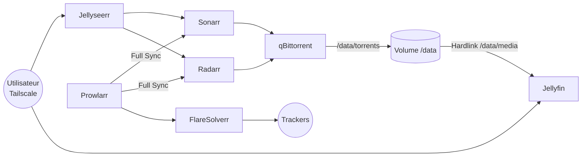

# Stack Servarr : Infrastructure Multimédia Automatisée sous Docker


Ce projet déploie une infrastructure multimédia entièrement automatisée sous Docker. Un utilisateur demande un film ou une série, et la chaîne se charge du reste : recherche sur les indexers, téléchargement sécurisé, tri, renommage puis mise à disposition en streaming. Aucune intervention manuelle n'est nécessaire.

L'infrastructure est hébergée sur un serveur Debian. Aucun port d'administration n'est exposé sur Internet : on y accède uniquement par un réseau privé Tailscale.

---

## Points Clés du Projet

- **Automatisation de bout en bout** : une requête dans Jellyseerr déclenche toute la chaîne (Prowlarr > Sonarr/Radarr > qBittorrent > Jellyfin). La bibliothèque est rafraîchie dès qu'un fichier est importé.
- **Optimisation du stockage (hardlinks)** : téléchargements et médiathèque partagent le même volume `/data`. Un fichier en seed et sa copie dans la bibliothèque pointent vers les mêmes blocs sur le disque. Il n'occupe donc l'espace qu'une seule fois.
- **Sécurité P2P pour trackers privés** : chiffrement exigé, DHT, PeX et LSD désactivés pour éviter les fuites d'IP. Le ratio est plafonné à 1.0, puis le torrent est purgé automatiquement par Sonarr/Radarr (Remove Completed).
- **Contournement des restrictions** : un proxy FlareSolverr résout les challenges Cloudflare des trackers, et le DNS est forcé sur 1.1.1.1 au niveau des conteneurs pour passer le filtrage DNS du FAI.
- **Cloisonnement réseau** : les interfaces web n'écoutent que sur l'IP Tailscale de l'hôte (100.x.x.x). Les conteneurs communiquent entre eux par leur nom sur un réseau bridge Docker dédié, sans dépendre d'IP dynamiques.
- **Synchronisation centralisée** : Prowlarr est la seule source de vérité pour les indexers. En mode Full Sync, il les pousse automatiquement vers Sonarr et Radarr.

---

## Architecture



| Service | Rôle |
|---|---|
| **Jellyfin** | Serveur de streaming multimédia |
| **Jellyseerr** | Portail de requêtes pour les utilisateurs |
| **Sonarr / Radarr** | Orchestration PVR : recherche, sélection de qualité, import et renommage |
| **Prowlarr** | Gestion centralisée des indexers |
| **FlareSolverr** | Proxy de contournement des protections Cloudflare |
| **qBittorrent** | Client de téléchargement P2P |

---

## Stack Technique

- **Système hôte** : Debian Linux
- **Conteneurisation** : Docker Engine, Docker Compose v2 (images linuxserver.io)
- **Réseau** : Tailscale (VPN mesh WireGuard), réseau bridge Docker interne
- **Stockage** : arborescence unifiée `/data` compatible hardlinks (convention TRaSH Guides)

---

## Arborescence

```
/mediatheque
├── docker-compose.yml
├── config/              # Configuration persistante de chaque service
└── data/
    ├── torrents/        # Zone de seed (qBittorrent)
    │   ├── radarr/
    │   └── tv-sonarr/
    └── media/           # Bibliothèque (Jellyfin)
        ├── movies/
        └── tv/
```

---

## Documentation Détaillée

Tout le déploiement est documenté pas à pas dans le fichier principal : préparation du système, fichier Docker Compose, configuration de chaque application dans l'ordre des dépendances, tests de validation, résolution d'incidents et sauvegarde.

**[Documentation complète (DOCUMENTATION.md)](./DOCUMENTATION.md)**

---

## Avertissement

Ce projet sert à apprendre l'administration système, la conteneurisation et la sécurisation réseau. L'utilisateur reste seul responsable des contenus qu'il télécharge et partage, dans le respect de la législation en vigueur et du droit d'auteur.
`
